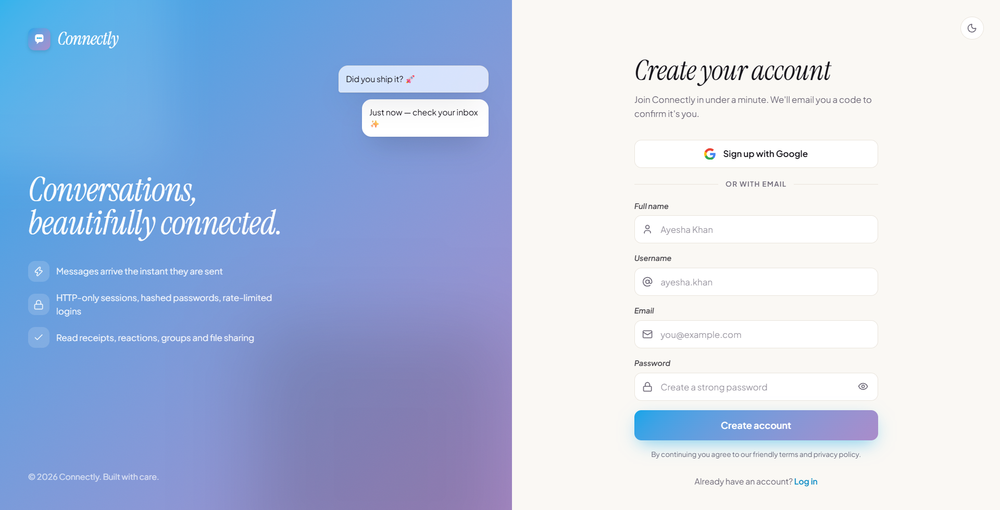
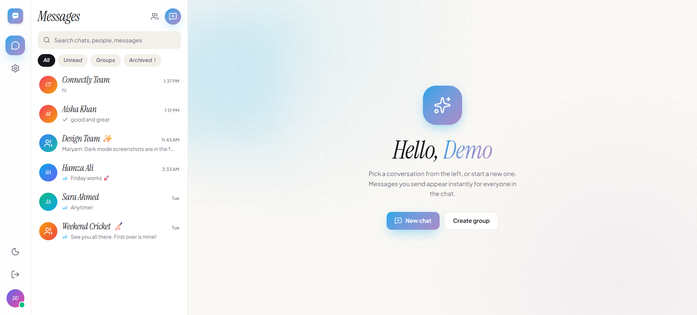
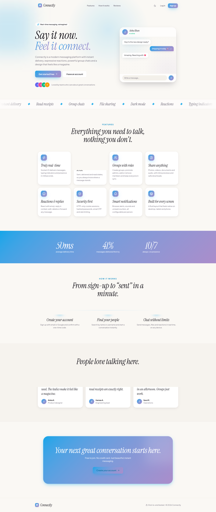

# Connectly

A full-stack real-time messaging platform built with React, Node.js, Express, and MongoDB.

Connectly brings private conversations, group messaging, media sharing, and real-time communication together in a clean, responsive interface.

## Features

- **Authentication:** Registration, login, email OTP verification, Google sign-in, password recovery, and secure HTTP-only JWT cookies.
- **Real-time messaging:** One-to-one and group chats, online status, typing indicators, and message delivery/read receipts.
- **Message management:** Reply, edit, delete, forward, react, search, and retry failed messages.
- **Media sharing:** Upload and preview images, videos, audio, and documents.
- **Groups:** Create groups, manage members, assign administrators, and control group settings.
- **User dashboard:** Profiles, privacy, notifications, themes, chat settings, and account management.
- **Admin dashboard:** Platform statistics, user management, moderation, and role-based permissions.
- **Security:** Password hashing, input validation, rate limiting, security headers, and access control.
- **Responsive design:** Desktop and mobile layouts, light and dark themes, and smooth animations.

## Tech Stack

| Frontend        | Backend   | Database & Services |
| --------------- | --------- | ------------------- |
| React 19        | Node.js   | MongoDB             |
| Vite            | Express   | Mongoose            |
| Tailwind CSS v4 | Socket.IO | Cloudinary          |
| Axios           | JWT       | Nodemailer          |
|                 | bcrypt    | Google Sign-In      |

## Screenshots

### Landing Page



### Chat Interface



### Full Website



## Getting Started

**Requirements:** Node.js 18+ and MongoDB (local or Atlas).

1. Clone the repository:

```bash
git clone https://github.com/devsaheem007/connectly.git
cd connectly
```

2. Install dependencies:

```bash
npm run install:all
```

3. Create your environment file:

```bash
cp server/.env.example server/.env
```

On Windows Command Prompt, use:

```cmd
copy server\.env.example server\.env
```

4. Configure the required environment variables (see below).

5. Start the application:

```bash
npm run dev
```

Open **http://localhost:5173**.

## Environment Variables

Configure these in `server/.env`:

| Variable                                           | Purpose                                   |
| -------------------------------------------------- | ----------------------------------------- |
| `MONGO_URI`                                        | MongoDB connection string                 |
| `JWT_SECRET`                                       | Secret used to sign authentication tokens |
| `CLIENT_URL`                                       | Frontend URL                              |
| `PORT`                                             | API port (default: 5000)                  |
| `SMTP_HOST`, `SMTP_PORT`, `SMTP_USER`, `SMTP_PASS` | Email configuration                       |
| `EMAIL_FROM`                                       | Sender email address                      |
| `CLOUDINARY_*`                                     | Cloudinary file storage credentials       |
| `GOOGLE_CLIENT_ID`                                 | Google sign-in configuration              |
| `JWT_EXPIRES_DAYS`                                 | Session duration                          |
| `COOKIE_SAMESITE`                                  | Cookie cross-site policy                  |
| `ALLOW_DEMO_LOGIN`                                 | Demo-login configuration                  |
| `SERVE_CLIENT`                                     | Serve the built frontend from the API     |
| `SEED_ADMIN_PASSWORD`                              | Password for a seeded admin account       |

Generate a secure JWT secret:

```bash
node -e "console.log(require('crypto').randomBytes(48).toString('hex'))"
```

See `server/.env.example` for the complete configuration.

## Project Structure

```text
connectly/
├── client/
│   └── src/
│       ├── pages/
│       ├── components/
│       ├── context/
│       ├── hooks/
│       └── lib/
│
├── server/
│   ├── config/
│   ├── models/
│   ├── controllers/
│   ├── routes/
│   ├── middleware/
│   ├── services/
│   ├── socket/
│   ├── utils/
│   └── scripts/
│
├── package.json
└── README.md
```

## Deployment

Connectly supports both single-server and separate frontend/backend deployment.

**Frontend:** Vercel  
**Backend:** Render  
**Database:** MongoDB Atlas

For separate deployment:

- Build the client with `VITE_API_URL` configured to your production API URL.
- Configure the backend's `CLIENT_URL` with your frontend URL.
- Set `NODE_ENV=production`.
- Configure `COOKIE_SAMESITE=none` when using separate HTTPS domains.
- Configure Cloudinary for persistent file storage.
- Add all required production environment variables to the hosting platforms.

For single-server deployment, build the frontend using `npm run build`, set `SERVE_CLIENT=true`, and start with `npm start`.

## Testing

Run the backend smoke tests:

```bash
npm test
```

Tests cover authentication, user permissions, profiles, uploads, messaging, Socket.IO events, groups, and admin functionality.

Tests use a separate database (`TEST_MONGO_URI` can override the default). The test database is deleted after testing; never point it at your production database.

## Security Notes

- Never commit `.env` files or private credentials.
- Use strong, unique production secrets.
- Disable demo login in production.
- Restrict MongoDB network access.
- Use HTTPS and persistent cloud storage in production.
- Never run `npm run seed:reset` against a database containing data you want to keep.

---

**Built with care by Saheem Qudoos.**
